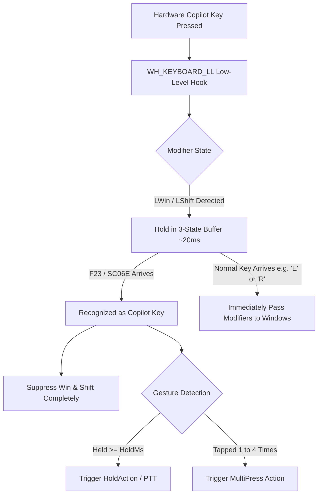

<div align="center">

# ⌨️ Copilot Button

**Transform your laptop's dedicated Copilot key into a high-performance, programmable multifunction button.**

[](https://github.com/KeremKuyucu/copilot-button/releases)
[](https://github.com/KeremKuyucu/copilot-button)
[](https://github.com/KeremKuyucu/copilot-button)
[](LICENSE)
[](https://github.com/KeremKuyucu/copilot-button/releases)

<p align="center">
  <a href="#-english">English</a> •
  <a href="#-türkçe">Türkçe</a>
</p>

</div>

---

# 🌐 English

## 📖 Overview

Modern Windows laptops (ASUS, Dell, Lenovo, HP, Surface, etc.) and keyboards come equipped with a dedicated Microsoft Copilot hardware key. Mechanically and digitally, this key emits a composite scan code sequence:
$$\text{Left Windows} + \text{Left Shift} + \text{F23}$$
*(or `VK_LAUNCH_APP1` / `SC06E` depending on the OEM).*

Generic key remapping tools frequently leak the `Windows` key event, causing the Start Menu to flash unexpectedly, or introduce perceptible latency into normal typing (`Win + E`, `Win + R`, `Shift` combinations).

**Copilot Button** is a native, ultra-lightweight Windows utility built with **C++20** that intercepts the Copilot key at the OS kernel hook level using a **3-State Anti-Leak State Machine**. It swallows unwanted modifier signals, prevents the Start Menu from popping up, and unlocks a full suite of gestures (single/multi-tap, press-and-hold, Push-to-Talk, Spotify/media controls, audio muting, and custom app launchers) paired with a modern Windows 11 On-Screen Display (OSD).

---

## ✨ Key Features

- 🛡️ **Zero-Leak Interception**:
  - Advanced 3-State Anti-Leak state machine eliminates accidental Start Menu or Shift activations.
  - Microsecond-level timer buffering (15–25 ms) guarantees regular Windows shortcuts (`Win+R`, `Win+E`, `Shift+A`) and gaming inputs pass through with zero noticeable lag.
  - 80 ms trailing suppression prevents ghost release inputs.
- ⚡ **Multi-Click Gestures**:
  - Configure distinct actions for **1-click**, **2-clicks**, **3-clicks**, and **4-clicks** within a customizable time window (`DoubleTapMs`).
- 🎙️ **Push-to-Talk & Smart Audio Control**:
  - **Push-to-Talk (PTT)**: Unmutes your default microphone while held, automatically mutes upon release.
  - **Mic Mute**: Instant microphone mute/unmute toggle.
  - **Master Mute**: Toggle system-wide speaker audio.
  - **Discord-Style Deafen (`ToggleDeafen`)**: Mute/unmute microphone and system audio simultaneously.
  - **Bi-directional Core Audio Sync**: Listens to `IAudioEndpointVolumeCallback` events to instantly reflect hardware headset mute buttons or Windows Settings changes.
- 🎵 **Universal Windows Media Integration**:
  - Global media transport integration via Windows WinRT (`GlobalSystemMediaTransportControlsSessionManager`).
  - Supports Play/Pause, Next Track, Previous Track across all media players: Spotify, YouTube / Chrome, Edge, Apple Music, VLC, Firefox, Tidal, Deezer, etc.
  - Displays a dedicated floating OSD card with track title and artist or source app name whenever the media changes.
- 🖥️ **Windows 11 Fluent On-Screen Display (OSD)**:
  - Hardware-accelerated layered floating badge with DWM rounded corners (`DWMWA_WINDOW_CORNER_PREFERENCE`).
  - Smooth alpha fade-in and fade-out animations.
  - Fully customizable: screen placement (`TopLeft`, `TopRight`, `BottomLeft`, `BottomRight`, `Center`), hex color, font size, and duration.
- 🟢 **Live Microphone Badge Overlay**:
  - Always-on-top, subtle indicator showing real-time microphone status.
- 🔄 **Dynamic Live Hot-Reload**:
  - Built-in background file watcher (`ReadDirectoryChangesW`) monitors `config.ini` in real time. Modify your settings and see them take effect instantly without restarting.
- 🚀 **Zero-Friction Self-Installation & Setup**:
  - Automatically relocates itself to `%LOCALAPPDATA%\CopilotButton\CopilotButton.exe` and cleans up the downloaded source file.
  - Registers with the Windows shell (AUMID `KeremKuyucu.CopilotButton`, App Paths, Start Menu shortcut, and **Windows Settings > Installed apps** registry).
  - Clean uninstallation via Windows Settings (*Installed apps*) or `--uninstall` argument.
  - Automatically configures Task Scheduler auto-start (`/rl highest`) avoiding UAC prompts and broken duplicate Run entries if enabled (`AutoStart=1`).
- 🪶 **Extreme Efficiency**:
  - 100% Native C++20 (Win32, COM, WinRT).
  - No Electron, no Python, no .NET runtime required.
  - Consumes **< 10 MB RAM** and compiles to a single standalone **~440 KB** binary.

---

## 🛠️ How It Works



1. When you press the Copilot key, the keyboard hardware fires `LWin Down`, `LShift Down`, and `F23 Down` in rapid succession.
2. The hook catches `LWin` and pauses for **25 ms** (`OnWinPassTimer`). If `LShift` arrives, it pauses for **15 ms** (`OnShiftPassTimer`).
3. If `F23` (or `VK_LAUNCH_APP1` / `SC06E`) arrives within that threshold, it confirms the Copilot key, cancels modifier timers, and prevents the Windows Start Menu from ever opening.
4. If any other key is pressed during the buffer period, the modifiers are dispatched immediately to Windows so normal shortcuts (`Win+E`, `Shift+W`, etc.) never lag.

---

## 🎮 Supported Actions

| Action | Description | Default Gesture |
| :--- | :--- | :--- |
| `MicMute` | Toggle default recording device (microphone) mute state | **1 Tap** |
| `PlayPause` | Media Play / Pause key (`VK_MEDIA_PLAY_PAUSE`) | **2 Taps** |
| `NextTrack` | Media Next Track key (`VK_MEDIA_NEXT_TRACK`) | **3 Taps** |
| `PrevTrack` | Media Previous Track key (`VK_MEDIA_PREV_TRACK`) | - |
| `MasterMute` | Toggle default playback device (master audio) mute | - |
| `ToggleDeafen` | Simultaneously mute/unmute both microphone and speakers | - |
| `LockScreen` | Instantly lock your Windows workstation | - |
| `CustomApp` | Launch an application (`.exe`) or open a web URL | - |
| `PushToTalk` | Unmute microphone while key is held, mute upon release | **Hold** |
| `None` | Ignore key press / no action | **4 Taps** |

---

## ⚙️ Configuration (`config.ini`)

`config.ini` is automatically created on first launch in the application folder or `%LOCALAPPDATA%\CopilotButton\config.ini`. Any edit is **hot-reloaded instantly**.

```ini
[Settings]

; ── Timing & Tap Actions ──
; Maximum wait time between clicks (milliseconds)
DoubleTapMs=250

; Minimum hold duration to trigger hold action (milliseconds)
HoldMs=250

; 1-Tap Action (MicMute, PlayPause, NextTrack, PrevTrack, MasterMute, ToggleDeafen, LockScreen, None)
Action1=MicMute

; 2-Taps Action
Action2=PlayPause

; 3-Taps Action
Action3=NextTrack

; 4-Taps Action
Action4=None

; Press-and-Hold Action (PushToTalk or CustomApp)
HoldAction=PushToTalk

; Path or URL when CustomApp is selected (e.g. C:\Program Files\App.exe or https://gemini.google.com)
CustomAppPath=

; ── System & Startup ──
; Auto-start with Windows (1 = Enabled, 0 = Disabled)
AutoStart=1

; Play audio cue when microphone is muted/unmuted (1 = Enabled, 0 = Disabled)
SoundFxEnabled=1

; ── Media & OSD Settings ──
; Show floating OSD card on track change (Spotify, YouTube, VLC, etc.) (1 = Enabled, 0 = Disabled)
MediaTrackOsd=1

; Persistent Media OSD: Stays at the bottom-left while music plays, auto-hides on fullscreen (1 = Enabled, 0 = Disabled)
MediaOsdPersistent=1

; Media Card Position: BottomLeft, BottomRight, TopLeft, TopRight, Center
MediaOsdPosition=BottomLeft

; General Notification OSD Screen Position: TopLeft, TopRight, BottomLeft, BottomRight, Center
OsdPosition=TopLeft

; OSD Text & Accent Color (Hex format without #)
OsdColor=00E5FF

; OSD Font Size (Default: 10)
OsdFontSize=10

; OSD Display Duration (milliseconds)
OsdDurationMs=1500

; Smooth OSD Fade In / Fade Out Animation (1 = Enabled, 0 = Disabled)
OsdFadeEnabled=1
```

---

## 📥 Installation & Usage

1. Download `CopilotButton.exe` from the [Latest Release](https://github.com/KeremKuyucu/copilot-button/releases/latest).
2. Double-click to run.
3. The app automatically relocates itself to `%LOCALAPPDATA%\CopilotButton\`, cleans up the downloaded file, registers with Windows, and runs in the system tray. If `AutoStart=1` in `config.ini`, it automatically launches on Windows startup.

---

## 🔨 Building from Source

### Prerequisites
- Windows 10 / 11 (64-bit)
- MinGW-w64 (GCC 11+ supporting C++20) or MSVC (Visual Studio 2022)
- CMake 3.20 or newer (optional for CMake builds)

### Fast Build via Script (MinGW)
```cmd
git clone https://github.com/KeremKuyucu/copilot-button.git
cd copilot-button
scripts\build.bat
```

### CMake Build (MinGW or MSVC)
```cmd
mkdir build
cd build
cmake .. -DCMAKE_BUILD_TYPE=Release
cmake --build . --config Release
```

The resulting optimized standalone executable will be generated at `./CopilotButton.exe`.

---

# 🇹🇷 Türkçe

## 📖 Genel Bakış

Yeni nesil Windows dizüstü bilgisayarlarda (ASUS, Dell, Lenovo, HP, Surface vb.) ve klavyelerde fiziksel bir Microsoft Copilot tuşu bulunmaktadır. Bu tuşa basıldığında donanım işletim sistemine şu tuş kombinasyonunu gönderir:
$$\text{Sol Windows} + \text{Sol Shift} + \text{F23}$$
*(veya üreticiye göre `VK_LAUNCH_APP1` / `SC06E`).*

Piyasadaki genel tuş atama programları bu tuşu yakalamaya çalışırken genellikle `Windows` tuşunu kaçırır (Başlat menüsü aniden açılıp kapanır) veya normal tuş kombinasyonlarında (`Win + E`, `Win + R`, `Shift` ile yazım) gecikmelere sebep olur.

**Copilot Button**, bu sorunu işletim sistemi kancası (low-level hook) seviyesinde çözen, **C++20** ile geliştirilmiş son derece hafif bir Windows uygulamasıdır. **3-State Anti-Leak Durum Makinesi** sayesinde Başlat menüsü sızıntılarını tamamen engeller; Copilot tuşunu çoklu tıklama, basılı tutma, Bas-Konuş (Push-to-Talk), Spotify/medya kontrolleri ve modern Windows 11 ekran bildirimleri (OSD) ile güçlü bir asistana dönüştürür.

---

## ✨ Öne Çıkan Özellikler

- 🛡️ **Sıfır Sızıntılı Donanım Yakalama (Anti-Leak)**:
  - 3-aşamalı durum makinesi sayesinde Windows tuşunun Başlat menüsünü tetiklemesini veya Shift tuşunun sistemde takılı kalmasını tamamen engeller.
  - 15–25 ms zamanlayıcı tamponu, `Win+R`, `Win+E` gibi normal kısayolların ve oyun tuşlarının sıfır gecikmeyle çalışmasını sağlar.
  - 80 ms bırakma tamponu ile hayalet basımları önler.
- ⚡ **Çoklu Tıklama Hareketleri**:
  - Ayarlanabilir zaman penceresinde **1 Tık**, **2 Tık**, **3 Tık** ve **4 Tık** için farklı eylemler tanımlayın.
- 🎙️ **Bas-Konuş (Push-to-Talk) ve Gelişmiş Ses Denetimi**:
  - **Push-to-Talk (PTT)**: Tuşa basılı tuttuğunuz sürece mikrofon açılır, bıraktığınızda otomatik olarak susturulur.
  - **Mic Mute**: Tek tıkla varsayılan mikrofonu susturun/açın.
  - **Master Mute**: Ana hoparlör sesini susturun/açın.
  - **Discord Benzeri Kulaklık/Mikrofon Kapatma (`ToggleDeafen`)**: Hem mikrofonu hem hoparlörü aynı anda kapatıp açın.
  - **Core Audio Donanım Senkronizasyonu**: Kulaklık üzerindeki fiziksel tuştan veya Windows ayarlarından gelen durum değişikliklerini anında yakalar.
- 🎵 **Evrensel Windows Medya Entegrasyonu (Spotify, YouTube, VLC vb.)**:
  - Windows WinRT medya denetleyicisi ile Oynat/Duraklat, Sonraki Parça ve Önceki Parça desteği.
  - Spotify, YouTube/Chrome, Edge, Apple Music, VLC, Deezer, Tidal dahil tüm medya kaynaklarını anlık yakalar; parça değiştiğinde başlık ve kaynak/sanatçı bilgisini şık bir OSD kartı olarak ekranda gösterir.
- 🖥️ **Windows 11 Uyumlu Ekran Bildirimi (OSD)**:
  - DWM yuvarlatılmış köşeli (`DWMWA_WINDOW_CORNER_PREFERENCE`), yarı saydam ve modern koyu tema bildirimleri.
  - Akıcı açılma/kapanma (fade) animasyonları.
  - Konum (`TopLeft`, `TopRight`, `BottomLeft`, `BottomRight`, `Center`), font boyutu, renk ve süre özelleştirmesi.
- 🟢 **Sürekli Mikrofon Rozeti**:
  - Ekranın köşesinde mikrofonun o an açık mı kapalı mı olduğunu gösteren hafif durum rozeti.
- 🔄 **Canlı Yapılandırma Yenileme (Hot-Reload)**:
  - `config.ini` dosyasında yaptığınız değişiklikler arka plan dosya izleyicisi tarafından anında algılanır; uygulamayı yeniden başlatmanız gerekmez.
- 🚀 **Otomatik Kurulum, Yerleşim ve Temiz Kaldırma**:
  - Exe dosyasını ilk açtığınızda kendini otomatik olarak `%LOCALAPPDATA%\CopilotButton\CopilotButton.exe` konumuna taşır ve indirilen geçici kaynak dosyayı temizler.
  - Kendini Windows'a resmi bir uygulama olarak tanıtır (AUMID, App Paths, Başlat menüsü kısayolu ve **Windows Ayarları > Yüklü Uygulamalar** kayıt girdisi).
  - İstenildiğinde Windows Ayarları listesinden (*Kaldır*) veya `--uninstall` parametresiyle tüm kalıntılarıyla birlikte kolayca silinebilir.
  - `config.ini` içinde `AutoStart=1` ise başlangıçta Görev Zamanlayıcı (`/rl highest`) kullanarak UAC uyarısız ve çakışmasız otomatik başlatma sağlar (yönetici izinli uygulamaları yutan Run anahtarı kirliliği oluşturmaz).
- 🪶 **Üstün Performans**:
  - Saf C++20 (Win32 API, COM, WinRT). Electron veya harici kütüphane içermez.
  - **< 10 MB RAM** tüketimi, ~440 KB tek parça bağımsız çalıştırılabilir dosya.

---

## 🎮 Desteklenen Eylemler

| Eylem | Açıklama | Varsayılan |
| :--- | :--- | :--- |
| `MicMute` | Varsayılan mikrofonu susturur / açar | **1 Tık** |
| `PlayPause` | Medyayı Oynat / Duraklat | **2 Tık** |
| `NextTrack` | Sonraki parçaya geç | **3 Tık** |
| `PrevTrack` | Önceki parçaya dön | - |
| `MasterMute` | Sistem ana sesini susturur / açar | - |
| `ToggleDeafen` | Mikrofon ve hoparlörü aynı anda susturur / açar | - |
| `LockScreen` | Windows oturumunu kilitler (`LockWorkStation`) | - |
| `CustomApp` | Belirtilen bir uygulamayı (`.exe`) veya web adresini açar | - |
| `PushToTalk` | Basılı tutulduğunda konuş, bırakıldığında sustur | **Basılı Tutma** |
| `None` | İşlem yapma / Yok say | **4 Tık** |

---

## ⚙️ Yapılandırma Kılavuzu (`config.ini`)

İlk çalıştırmada otomatik oluşturulan `config.ini` dosyasını sistem tepsisindeki Copilot simgesine sağ tıklayıp **"Settings"** diyerek doğrudan açabilirsiniz:

```ini
[Settings]

; Tıklama için maksimum bekleme süresi (milisaniye)
DoubleTapMs=250

; Basılı tutma için minimum süre (milisaniye)
HoldMs=250

; 1, 2, 3 ve 4 Tık Eylemleri
Action1=MicMute
Action2=PlayPause
Action3=NextTrack
Action4=None

; Basılı Tutma Eylemi (PushToTalk veya CustomApp)
HoldAction=PushToTalk

; CustomApp seçildiğinde açılacak uygulama yolu veya web bağlantısı
CustomAppPath=

; Windows başlangıcında otomatik çalıştır (1 = Açık, 0 = Kapalı)
AutoStart=1

; Mikrofon açılıp kapandığında Windows ses efekti çal
SoundFxEnabled=1

; Medya (Spotify, YouTube, VLC vb.) şarkı değişiminde ekranda parça kartı göster
MediaTrackOsd=1

; Sürekli Medya OSD: Şarkı çaldığı sürece sol altta göster, tam ekranda gizle (1 = Açık, 0 = Kapalı)
MediaOsdPersistent=1

; Sürekli Medya Kartı Konumu: BottomLeft, BottomRight, TopLeft, TopRight, Center
MediaOsdPosition=BottomLeft

; Genel Bildirim OSD Konumu: TopLeft, TopRight, BottomLeft, BottomRight, Center
OsdPosition=TopLeft

; OSD Metin / Vurgu Rengi (# olmadan hex)
OsdColor=00E5FF

; OSD Yazı Boyutu ve Süresi
OsdFontSize=10
OsdDurationMs=1500
OsdFadeEnabled=1
```

---

## 📥 Kurulum ve Kullanım

1. [En Son Sürüm](https://github.com/KeremKuyucu/copilot-button/releases/latest) sayfasından `CopilotButton.exe` dosyasını indirin.
2. Çift tıklayarak çalıştırın.
3. Uygulama kendini otomatik olarak `%LOCALAPPDATA%\CopilotButton\` klasörüne taşır, indirilen dosyayı temizler, Windows'a tanıtır ve sistem tepsisinde arka planda çalışmaya başlar. `config.ini` içinde `AutoStart=1` ise her Windows açılışında otomatik başlar.

---

## 🔨 Kaynaktan Derleme

### MinGW ile Hızlı Derleme
```cmd
git clone https://github.com/KeremKuyucu/copilot-button.git
cd copilot-button
scripts\build.bat
```

### CMake ile Derleme
```cmd
mkdir build
cd build
cmake .. -DCMAKE_BUILD_TYPE=Release
cmake --build . --config Release
```

Derleme tamamlandığında tek parça `CopilotButton.exe` dosyası kök dizinde hazır olacaktır.

---

## 📂 Proje Yapısı

```
copilot-button/
├── include/                 # C++ Header dosyaları
│   ├── Actions.hpp          # Eylem dağıtıcı arayüzü
│   ├── AppRegister.hpp      # Windows AUMID, Başlat menüsü ve AutoStart
│   ├── Audio.hpp            # Core Audio, EndpointVolume ve ses efektleri
│   ├── Config.hpp           # Yapılandırma modelleri ve Hot-Reload izleyicisi
│   ├── KeyHook.hpp          # 3-State Anti-Leak klavye kancası
│   ├── MicOverlay.hpp       # Sürekli mikrofon durum rozeti
│   ├── Osd.hpp              # Windows 11 DWM OSD yöneticisi
│   ├── MediaTracker.hpp     # WinRT evrensel medya ve parça izleme
│   └── Tray.hpp             # Sistem tepsisi (Tray icon) ve menü
├── src/                     # C++ Kaynak kodları
│   ├── main.cpp             # WinMain, Single-Instance ve ana mesaj döngüsü
│   ├── Actions.cpp          # Eylem yürütme mantığı
│   ├── AppRegister.cpp      # Kurulum ve kayıt defteri işlemleri
│   ├── Audio.cpp            # Windows ses COM arayüzleri
│   ├── Config.cpp           # INI ayrıştırma ve dizin izleme
│   ├── KeyHook.cpp          # Düşük seviyeli klavye hook ve durum makinesi
│   ├── MicOverlay.cpp       # Rozet penceresi çizimi ve yönetimi
│   ├── Osd.cpp              # Ekran bildirimleri ve fade animasyonları
│   ├── MediaTracker.cpp     # WinRT medya oturumu dinleyicisi
│   └── Tray.cpp             # Tepsi simgesi etkileşimleri
├── resources/               # İkon, manifest ve kaynak scriptleri
│   ├── app.manifest         # requireAdministrator & DPI farkındalık bildirimi
│   ├── app.rc               # Sürüm ve ikon kaynak tanımları
│   └── logo.ico             # Uygulama simgesi
├── scripts/                 # Otomasyon scriptleri
│   ├── build.bat            # MinGW C++20 derleme betiği
│   └── bump-version.bat     # Otomatik sürüm artırma betiği
├── CMakeLists.txt           # CMake yapılandırması (MSVC & GCC)
└── LICENSE                  # GNU General Public License v3.0
```

---

## 📄 Lisans

Bu proje [GNU General Public License v3.0](LICENSE) kapsamında lisanslanmıştır.
Telif Hakkı (c) 2026 Kerem Kuyucu.
