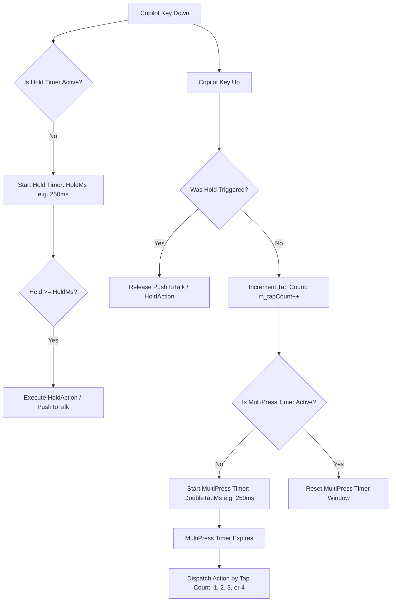

# Input Subsystem & 3-State Anti-Leak State Machine

## 1. The Hardware Copilot Key Problem

Modern Windows OEM keyboards (e.g., ASUS, Dell, HP, Lenovo, Surface) feature a dedicated physical Microsoft Copilot key. At the hardware and controller level, pressing this key transmits a rapid composite sequence of scan codes:

$$\text{Left Windows} \rightarrow \text{Left Shift} \rightarrow \text{F23} \quad (\text{or } \text{VK\_LAUNCH\_APP1} / \text{SC06E})$$

When standard key remapping utilities capture the final key (`F23`), the preceding `Left Windows` and `Left Shift` keys have already been dispatched to the operating system. Consequently:
1. The Windows Start Menu flashes open unexpectedly when the key is released.
2. If remapping software attempts naive suppression of the `Windows` key, normal user shortcuts (`Win + E`, `Win + R`, `Shift + W`, gaming keystrokes) suffer severe input lag or become unresponsive.

---

## 2. The 3-State Anti-Leak Solution

`Copilot Button` intercepts input using a low-level keyboard hook (`WH_KEYBOARD_LL`) in conjunction with a state machine and microsecond-level timer buffering.

```mermaid
stateDiagram-v2
    [*] --> Idle

    state "LWin Intercepted" as WinState {
        Idle --> WaitingWin : VK_LWIN Down
        WaitingWin --> Idle : 25ms Timer Expires (Pass Win)
        WaitingWin --> Idle : Unrelated Key Arrives (Pass Win Fast)
    }

    state "LShift Intercepted" as ShiftState {
        WaitingWin --> WaitingShift : VK_LSHIFT Down
        WaitingShift --> Idle : 15ms Timer Expires (Pass Win & Shift)
        WaitingShift --> Idle : Unrelated Key Arrives (Pass Both Fast)
    }

    state "Copilot Confirmed" as CopilotState {
        WaitingShift --> CopilotActive : VK_F23 / SC06E Down
        WaitingWin --> CopilotActive : VK_F23 / SC06E Down
        CopilotActive --> SuppressRelease : Suppress Win & Shift Signals
        SuppressRelease --> TrailingBlock : Key Up Detected
        TrailingBlock --> Idle : 80ms Trailing Window Expires
    }
```

### 2.1 State Definitions

#### CopState (Windows Key State)
- `CopState::Idle`: Normal state. No potential Copilot sequence in progress.
- `CopState::Waiting`: `VK_LWIN` key-down intercepted. A 25 ms watchdog timer (`TIMER_ID_WIN_PASS`) is started.
- `CopState::Copilot`: `VK_F23` (or `VK_LAUNCH_APP1` / scan code `0x006E`) confirmed within the timer window. The sequence is recognized as the Copilot hardware button.
- `CopState::Passed`: An unrelated keystroke arrived or the timer expired. The buffered `LWin` key-down is synthesized and passed to the OS.

#### ShiftState (Shift Key State)
- `ShiftState::Idle`: Normal state.
- `ShiftState::Waiting`: `VK_LSHIFT` key-down intercepted while in `CopState::Waiting`. A 15 ms watchdog timer (`TIMER_ID_SHIFT_PASS`) is started.
- `ShiftState::Passed`: The timer expired or an unrelated key was detected. The buffered `LShift` is synthesized and passed to the OS.

---

## 3. Timing Parameters & Buffering Invariants

| Timer ID | Constant | Threshold | Technical Function |
| :--- | :--- | :--- | :--- |
| `TIMER_ID_WIN_PASS` | `3` | `25 ms` | Maximum buffering duration for `VK_LWIN`. If no `LShift` or `F23` follows within 25 ms, `PassModifiers()` dispatches `LWin` to the OS. |
| `TIMER_ID_SHIFT_PASS` | `4` | `15 ms` | Maximum buffering duration for `VK_LSHIFT` following `LWin`. If no `F23` follows within 15 ms, `PassShiftOnly()` dispatches `LShift` to the OS. |
| Trailing Window | N/A | `80 ms` | Following the release of the Copilot key, any ghost release events for `LWin` or `LShift` arriving within 80 ms (`m_copilotJustReleased`) are swallowed. |

### 3.1 Fast-Path Unrelated Keystroke Dispatch
If the user presses a normal shortcut (such as `Win + E` or `Win + R`), the arrival of the regular key (`E` or `R`) is intercepted immediately while `m_copState == CopState::Waiting`. 

The hook immediately cancels the pending timer, dispatches the buffered `VK_LWIN` down event to the OS via `SendInput`, marks the state as `Passed`, and permits the incoming key to pass without suppression. This guarantees that user shortcuts experience zero perceptible latency.

---

## 4. Gesture Detection: Multi-Tap and Press-and-Hold

Once a valid Copilot key event is confirmed, the hook coordinates gesture recognition:



### 4.1 Press-and-Hold Logic
- A one-shot timer (`TIMER_ID_HOLD`, default 250 ms) begins on key-down.
- If the key remains held until the timer expires:
  - `m_holdTriggered` is set to `true`.
  - The configured `HoldAction` (e.g., `PushToTalk`, `RunAgy`, or `CustomApp`) is invoked.
  - For `PushToTalk`, the default capture endpoint is unmuted immediately.
- Upon key-up:
  - If `m_holdTriggered` was true and `m_pttActive` was engaged, the microphone is automatically muted again.
  - Multi-tap counters are not incremented if a hold was executed.

### 4.2 Multi-Click Aggregation
- If the key is released before `HoldMs`, `m_tapCount` is incremented.
- The multi-press timer (`TIMER_ID_MULTIPRESS`, default 250 ms) aggregates sequential presses.
- When the timer fires:
  - 1 tap $\rightarrow$ `Action1` (default: `MicMute`)
  - 2 taps $\rightarrow$ `Action2` (default: `PlayPause`)
  - 3 taps $\rightarrow$ `Action3` (default: `NextTrack`)
  - 4 taps $\rightarrow$ `Action4` (default: `None`)
  - `m_tapCount` resets to `0`.

