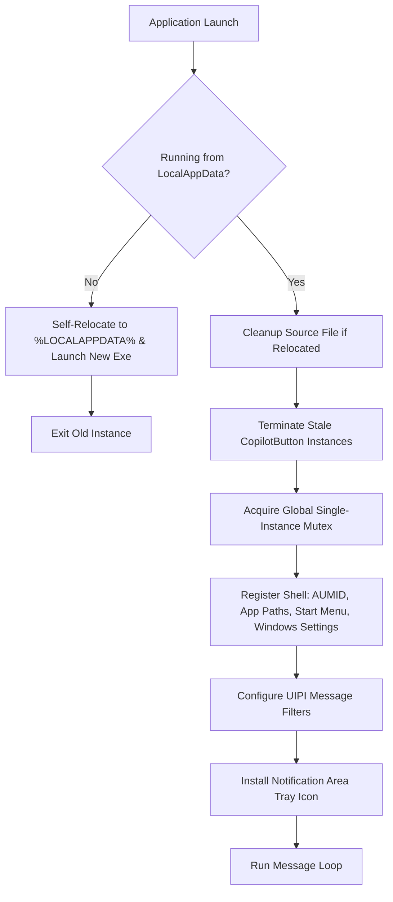

# Application Lifecycle, Shell Integration & System Registration

## 1. Overview

The application lifecycle and registration subsystem (`src/AppRegister.cpp`, `include/AppRegister.hpp`, `src/Tray.cpp`, `include/Tray.hpp`) governs process startup, self-installation, system registration, uninstallation, and notification area operations under Windows.



---

## 2. Startup & Self-Relocation Workflow

### 2.1 Fixed Destination Directory
The production binary is designed to run from a standardized location:
`%LOCALAPPDATA%\CopilotButton\CopilotButton.exe`

### 2.2 Relocation Logic (`CheckAndPerformSelfRelocate`)
1. Resolves the executable path via `GetModuleFileNameW`.
2. Queries the environment path for `%LOCALAPPDATA%`.
3. If running from an external folder (e.g., `Downloads`, Desktop, or USB drive):
   - Creates the destination directory `%LOCALAPPDATA%\CopilotButton`.
   - Copies itself to the target location (`CopyFileW`).
   - Copies existing `config.ini` if present.
   - Launches the newly copied binary via `CreateProcessW` passing a cleanup parameter (`--cleanup-old <old_path>`).
   - Terminates the temporary launcher process immediately.

### 2.3 Cleanup of Relocated Source
Upon launching with `--cleanup-old`, the new instance spawns a background thread waiting briefly for the original process to exit before deleting the initial download file (`DeleteFileW`).

---

## 3. Process Concurrency & Single-Instance Locking

### 3.1 Global Mutex Enforcement
To prevent multiple instances from competing for the `WH_KEYBOARD_LL` hook or audio callbacks, the application requests a named global mutex:
`Global\CopilotButton_SingleInstance_Mutex`

If `GetLastError() == ERROR_ALREADY_EXISTS`, the process aborts initialization and terminates.

### 3.2 Stale Instance Cleanup (`TerminateOldInstances`)
During system startup or unexpected crashes, orphaned background instances may hold system hooks. Before acquiring the mutex:
1. Enumerates processes via `CreateToolhelp32Snapshot(TH32CS_SNAPPROCESS, 0)`.
2. Compares process executable names (`CopilotButton.exe`).
3. For matches whose PID does not equal the current process ID (`currentPid`), opens the process (`PROCESS_TERMINATE`) and issues `TerminateProcess(hProcess, 0)`.

---

## 4. Windows Shell & Settings Registration

### 4.1 Application Identification (AUMID)
Sets the explicit Application User Model ID via `SetCurrentProcessExplicitAppUserModelID(L"KeremKuyucu.CopilotButton")`.

### 4.2 Start Menu Shortcut & App Paths
- **Start Menu**: Constructs an `IShellLinkW` shortcut in `%APPDATA%\Microsoft\Windows\Start Menu\Programs\Copilot Button.lnk` with the AUMID property attached via `IPropertyStore`.
- **App Paths**: Registers under `HKCU\Software\Microsoft\Windows\CurrentVersion\App Paths\CopilotButton.exe`, enabling direct execution through the `Win + R` Run dialog.

### 4.3 Windows Settings (Installed Apps) Registration
Registers an official entry in `HKCU\Software\Microsoft\Windows\CurrentVersion\Uninstall\CopilotButton`:
- `DisplayName`: "Copilot Button"
- `DisplayVersion`: Current semantic version (e.g., "3.2.1")
- `Publisher`: "Kerem Kuyucu"
- `InstallLocation`: `%LOCALAPPDATA%\CopilotButton`
- `DisplayIcon`: Target binary icon path
- `UninstallString`: `"%LOCALAPPDATA%\CopilotButton\CopilotButton.exe" --uninstall`

---

## 5. Elevated Autostart Management

Because `Copilot Button` runs with administrative privileges (`requireAdministrator` in `app.manifest`) to ensure reliable keyhook interception in elevated gaming and administrative contexts, standard registry `Run` keys (`HKCU\...\Run`) are ignored or swallowed by Windows Explorer on boot.

### 5.1 Task Scheduler Solution (`SetAutoStartRegistry`)
Instead of registry Run entries, autostart is managed via Windows Task Scheduler:
```powershell
schtasks /create /tn "CopilotButton" /tr "\"%LOCALAPPDATA%\CopilotButton\CopilotButton.exe\"" /sc onlogon /rl highest /f
```
- `/sc onlogon`: Runs automatically upon user logon.
- `/rl highest`: Grants highest privileges, bypassing UAC elevation prompts during startup.
- If `AutoStart=0`, the scheduled task is removed via `schtasks /delete /tn "CopilotButton" /f`.

---

## 6. User Interface Privilege Isolation (UIPI) Configuration

Under Windows UIPI, lower-integrity processes cannot send window messages to higher-integrity processes. Because `explorer.exe` runs at Medium integrity while `Copilot Button` runs at High integrity:
- System tray messages (`WM_USER_TRAY_ICON`) and taskbar restart notifications (`TaskbarCreated`) would normally be blocked.
- Fixed in v3.2.1 using message filtering:
```cpp
ChangeWindowMessageFilter(WM_CLOSE, MSGFLT_ADD);
ChangeWindowMessageFilter(WM_USER_TRAY_ICON, MSGFLT_ADD);
ChangeWindowMessageFilter(WM_COMMAND, MSGFLT_ADD);
ChangeWindowMessageFilter(g_uTaskbarRestart, MSGFLT_ADD);

ChangeWindowMessageFilterEx(hWnd, WM_CLOSE, MSGFLT_ALLOW, nullptr);
ChangeWindowMessageFilterEx(hWnd, WM_USER_TRAY_ICON, MSGFLT_ALLOW, nullptr);
ChangeWindowMessageFilterEx(hWnd, WM_COMMAND, MSGFLT_ALLOW, nullptr);
ChangeWindowMessageFilterEx(hWnd, g_uTaskbarRestart, MSGFLT_ALLOW, nullptr);
```

---

## 7. Complete Uninstaller Routine (`UninstallApp`)

When launched with `--uninstall` (either from Windows Settings > Installed apps or CLI):
1. Prompts user confirmation (unless `--silent` is provided).
2. Closes running instances.
3. Removes Task Scheduler autostart task (`schtasks /delete`).
4. Removes registry keys under `App Paths` and `Uninstall\CopilotButton`.
5. Removes Start Menu shortcuts.
6. Spawns an ephemeral self-deleting batch command to delete `%LOCALAPPDATA%\CopilotButton` after the executable unloads from memory.

