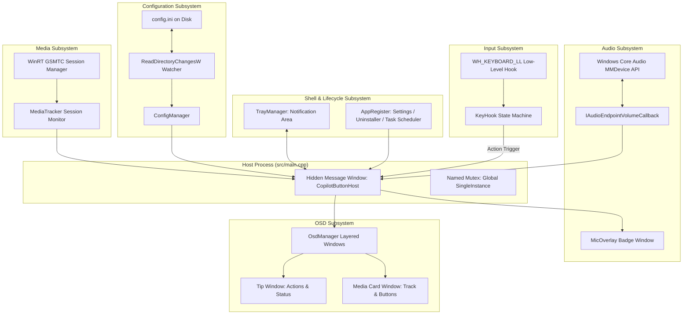

# System Architecture & Design Overview

## 1. Architectural Scope

`Copilot Button` is a native Windows utility implemented in C++20. It runs as a lightweight, single-binary background process without a visible console window (`-mwindows` / `WIN32`), managing system-level input interception, audio endpoint control, media session tracking, on-screen display (OSD) rendering, and shell integration.

---

## 2. Process & Thread Model

The application operates predominantly on a single UI message loop thread, supported by dedicated background threads for specific asynchronous tasks:

1. **Main UI & Message Thread**:
   - Owns the hidden host window (`CopilotButtonHost`).
   - Runs the Win32 message pump (`GetMessageW` / `DispatchMessageW`).
   - Owns the low-level keyboard hook callback context.
   - Manages layered window creation, painting, and animation timers for OSD elements.
   - Handles tray notifications, shell AppBar notifications, and WinEvent hook callbacks.

2. **Configuration File Watcher Thread (`ConfigManager::WatcherThread`)**:
   - Executes a dedicated worker thread monitoring the directory containing `config.ini` via `ReadDirectoryChangesW`.
   - Uses a non-blocking signaling mechanism (`m_stopEvent`) to cleanly shut down upon application exit.
   - Upon file modification, debounces write events, strips potential UTF-8 Byte Order Marks (BOM), parses updated configuration values, and dispatches `WM_USER_CONFIG_CHANGED` to the host window.

3. **WinRT Media Asynchronous Dispatchers**:
   - The Windows Runtime media control API dispatches session change notifications across thread pool callbacks.
   - `MediaTracker` synchronizes track metadata and thumbnail byte buffers, marshaling updates back to the main UI message thread via `PostMessageW(hWnd, WM_USER_TRACK_CHANGED, 0, 0)`.

---

## 3. Inter-Component Communication via Window Messages

To maintain strict thread safety without complex lock hierarchies in GUI rendering, asynchronous events are marshaled to the hidden host window via custom window messages:

| Message Constant | Identifier | Direction | Purpose |
| :--- | :--- | :--- | :--- |
| `WM_USER_TRAY_ICON` | `WM_USER + 100` | Explorer -> Host | Tray icon interaction events (clicks, context menu). |
| `WM_USER_MIC_STATE_CHANGED` | `WM_USER + 101` | Audio Callback -> Host | Notification that microphone mute state changed externally. |
| `WM_USER_TRACK_CHANGED` | `WM_USER + 102` | MediaTracker -> Host | Notification that current media track or play state changed. |
| `WM_USER_CONFIG_CHANGED` | `WM_USER + 103` | Config Watcher -> Host | Notification that `config.ini` was updated on disk. |
| `WM_USER_APPBAR_NOTIFY` | `WM_USER + 104` | Shell -> Host | AppBar notification indicating taskbar or fullscreen changes. |
| `TaskbarCreated` | `RegisterWindowMessageW` | Explorer -> Host | Broadcast message when `explorer.exe` restarts. |

---

## 4. Subsystem Breakdown

### 4.1 Input Subsystem (`include/KeyHook.hpp`, `src/KeyHook.cpp`, `src/Actions.cpp`)
- Intercepts low-level keyboard messages via `WH_KEYBOARD_LL`.
- Houses the 3-state anti-leak state machine to buffer composite modifier signals (`Win` and `Shift`) and verify arrival of `F23` or `SC06E`.
- Gathers multi-tap gestures and press-and-hold gestures, delegating execution to `DispatchAction`.

### 4.2 Audio Subsystem (`include/Audio.hpp`, `src/Audio.cpp`, `include/MicOverlay.hpp`, `src/MicOverlay.cpp`)
- Interfaces with Windows Core Audio endpoints (`IMMDeviceEnumerator`, `IAudioEndpointVolume`).
- Provides atomic control over default capture and playback endpoints (microphone mute, master mute, deafen).
- Hosts `IAudioEndpointVolumeCallback` for bidirectional hardware synchronization.
- Controls the floating, transparent microphone badge window reflecting current mute status.

### 4.3 Media Tracker Subsystem (`include/MediaTracker.hpp`, `src/MediaTracker.cpp`)
- Utilizes the modern Windows Runtime (`GlobalSystemMediaTransportControlsSessionManager`).
- Monitors playback state changes, metadata updates (Title, Artist), and extracts thumbnail image streams.
- Provides fallback media transport execution using standard virtual keys (`VK_MEDIA_PLAY_PAUSE`, `VK_MEDIA_NEXT_TRACK`, `VK_MEDIA_PREV_TRACK`).

### 4.4 OSD Subsystem (`include/Osd.hpp`, `src/Osd.cpp`)
- Implements two specialized layered windows:
  1. **Tip Window**: Ephemeral alpha-blended badge for action feedback and volume status.
  2. **Media Card Window**: Persistent or timed media card displaying track metadata, album thumbnail bitmap, and interactive transport buttons with hit-testing.
- Integrated with Shell AppBar APIs and WinEvent hooks to track taskbar position and suppress rendering during fullscreen applications.

### 4.5 Configuration Subsystem (`include/Config.hpp`, `src/Config.cpp`)
- Handles file I/O for `config.ini` using Win32 private profile string APIs.
- Employs automatic UTF-8 BOM stripping to prevent parsing failures.
- Operates a directory watcher thread for dynamic hot-reloading without application restarts.

### 4.6 Shell Registration & Lifecycle (`include/AppRegister.hpp`, `src/AppRegister.cpp`, `include/Tray.hpp`, `src/Tray.cpp`)
- Enforces single-instance execution via a global named mutex and terminates dangling stale processes.
- Relocates binary to `%LOCALAPPDATA%\CopilotButton\CopilotButton.exe` upon first run.
- Configures Task Scheduler autostart (`/rl highest`) and Windows Settings (Installed apps) uninstall registration.
- Configures User Interface Privilege Isolation (UIPI) message filters for elevated tray execution.

---

## 5. Build & Target Specification

- **C++ Standard**: C++20 (`set(CMAKE_CXX_STANDARD 20)`).
- **Subsystem**: Windows GUI (`WIN32` / `-mwindows`), preventing console window allocation.
- **Link Libraries**: `user32`, `shell32`, `ole32`, `oleaut32`, `uuid`, `winmm`, `advapi32`, `gdi32`, `dwmapi`, `windowsapp`, `gdiplus`, `shlwapi`, `msimg32`.
- **Target OS**: Windows 10 (Build 19041+) & Windows 11.

