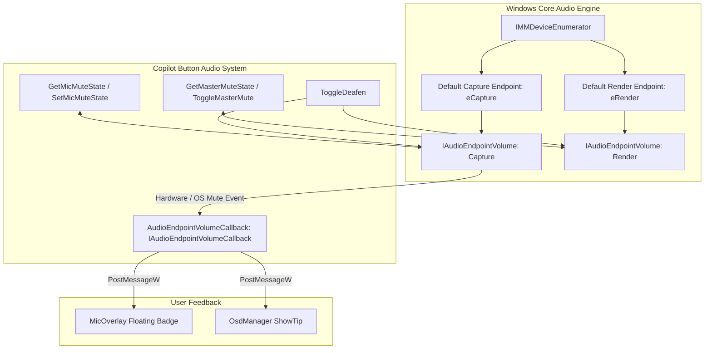

# Audio Subsystem & Core Audio Integration

## 1. Overview & Architecture

The audio subsystem (`src/Audio.cpp`, `include/Audio.hpp`) provides low-level control and real-time state synchronization for system recording (capture) and playback (render) endpoints. It communicates with the Windows Core Audio COM API without external dependencies.

---

## 2. Core Audio COM Interfaces

### 2.1 Enumeration & Endpoint Resolution
Audio endpoints are resolved dynamically to ensure changes in default devices (e.g., plugging in a USB headset or disconnecting Bluetooth earbuds) are handled seamlessly:
1. `CoCreateInstance` instantiates `CLSID_MMDeviceEnumerator`.
2. `GetDefaultAudioEndpoint` queries the active device:
   - Recording: `eCapture`, `eCommunications` (fallback to `eConsole`).
   - Playback: `eRender`, `eMultimedia` (fallback to `eConsole`).
3. `Activate` requests `IID_IAudioEndpointVolume`.

### 2.2 Volume & Mute Manipulation
Endpoint mute states are managed via `IAudioEndpointVolume`:
- `GetMute(&isMuted)`: Queries instantaneous mute state.
- `SetMute(bMute, nullptr)`: Mutates mute state atomically. Passing `nullptr` as the event context ensures registered callbacks receive notifications.

---

## 3. Bidirectional Hardware Synchronization

Headsets with physical mute toggles and Windows sound control applets can change mute states independently of `Copilot Button`. To maintain state coherence:

1. `RegisterMicNotification(std::function<void(bool)> cb)` instantiates an `IAudioEndpointVolumeCallback` implementation.
2. The callback is registered on the default capture volume interface via `RegisterControlChangeNotify`.
3. In `IAudioEndpointVolumeCallback::OnNotify(AUDIO_VOLUME_NOTIFICATION_DATA* pData)`:
   - The updated mute state (`pData->bMuted`) is forwarded to the registered callback.
   - The host window receives `WM_USER_MIC_STATE_CHANGED`, updating both `MicOverlay` and triggering an OSD tip.

---

## 4. Supported Audio Operations

| Operation | Implementation | Description |
| :--- | :--- | :--- |
| `MicMute` | `ToggleMicMute()` | Inverts current capture endpoint mute state. Plays feedback sound (`MB_OK` when unmuting, `MB_ICONHAND` when muting). |
| `PushToTalk` | `SetMicMuteState(false)` / `SetMicMuteState(true)` | Unmutes capture endpoint while the physical key is held; mutes capture endpoint immediately upon key release. |
| `MasterMute` | `ToggleMasterMute()` | Inverts current playback endpoint mute state. |
| `ToggleDeafen` | `ToggleDeafen()` | Reads current state. If either microphone or master audio is active, mutes both simultaneously. If both are muted, unmutes both simultaneously. |

---

## 5. Microphone Overlay Badge (`MicOverlay`)

`MicOverlay` (`src/MicOverlay.cpp`, `include/MicOverlay.hpp`) renders an always-on-top, non-intrusive visual indicator:
- Built as a layered window (`WS_EX_LAYERED | WS_EX_TOPMOST | WS_EX_TOOLWINDOW | WS_EX_TRANSPARENT | WS_EX_NOACTIVATE`).
- Positioned in the corner of the active primary display.
- Displays a visual dot or icon indicating:
  - **Muted**: Red badge / indicator.
  - **Unmuted / Active**: Green badge or hidden based on configuration.
- Ignores all mouse interaction (`WS_EX_TRANSPARENT`), allowing clicks to pass through directly to background applications.

