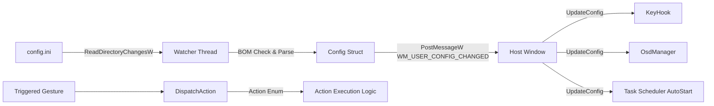

# Configuration System & Action Dispatching

## 1. Overview

The configuration subsystem (`src/Config.cpp`, `include/Config.hpp`, `src/Actions.cpp`, `include/Actions.hpp`) is responsible for managing application settings, watching the configuration file for real-time modifications, and mapping triggered gestures to specific system actions.



---

## 2. Configuration File Specification (`config.ini`)

The configuration file is formatted according to standard INI syntax. If missing, `EnsureConfigExists` automatically generates a default template in the working directory or `%LOCALAPPDATA%\CopilotButton\config.ini`.

### 2.1 INI Schema & Default Values

```ini
[Settings]
; Timing settings in milliseconds
DoubleTapMs=250
HoldMs=250

; Gestures: MicMute, PlayPause, NextTrack, PrevTrack, MasterMute, ToggleDeafen, LockScreen, CustomApp, PushToTalk, RunAgy, None
Action1=MicMute
Action2=PlayPause
Action3=NextTrack
Action4=None
HoldAction=PushToTalk

; Path or URL for CustomApp action
CustomAppPath=

; Audio & Autostart options
SoundFxEnabled=1
AutoStart=1

; RunAgy Terminal Launcher options
AgyPath=
AgyCommand=agy
AgyTerminal=wt
AgySendF5=0
AgyDelayMs=1000

; OSD Layout & Visual Appearance
OsdPosition=TopLeft
MediaOsdPosition=BottomLeft
OsdColorHex=B388FF
OsdFontSize=10
OsdDurationMs=1500
OsdFadeEnabled=1
MediaTrackOsd=1
MediaOsdPersistent=1
```

---

## 3. Robust INI Parsing & UTF-8 BOM Handling

Win32 profile parsing APIs (`GetPrivateProfileStringW`, `GetPrivateProfileIntW`) expect ANSI or UTF-16 encoding. When modern text editors (such as Notepad, VS Code) save UTF-8 files, they frequently prepend a 3-byte Byte Order Mark (`0xEF, 0xBB, 0xBF`).

### 3.1 The BOM Failure Mode
The Win32 API treats the initial section `[Settings]` prefixed with a BOM as `[Settings]`, causing section lookups to fail and silently reverting all configuration keys to default constants.

### 3.2 In-Place BOM Stripping (`StripUtf8Bom`)
Before reading values from disk, `StripUtf8Bom` inspects the initial 3 bytes:
```cpp
void StripUtf8Bom(const std::wstring& path) {
    HANDLE hFile = CreateFileW(path.c_str(), GENERIC_READ | GENERIC_WRITE, ...);
    BYTE bom[3] = {};
    DWORD read = 0;
    ReadFile(hFile, bom, 3, &read, nullptr);
    if (read == 3 && bom[0] == 0xEF && bom[1] == 0xBB && bom[2] == 0xBF) {
        // Reads remainder of file, seeks to offset 0, overwrites content without BOM, truncates file
        SetEndOfFile(hFile);
    }
    CloseHandle(hFile);
}
```

---

## 4. Live Dynamic Hot-Reloading

`ConfigManager` operates a dedicated background watcher thread using Win32 directory change notifications:

1. Resolves parent directory of `config.ini`.
2. Calls `FindFirstChangeNotificationW` or `ReadDirectoryChangesW` on the directory targeting `FILE_NOTIFY_CHANGE_LAST_WRITE | FILE_NOTIFY_CHANGE_SIZE`.
3. Waits on two synchronization handles using `WaitForMultipleObjects`:
   - `m_stopEvent`: Signals thread shutdown on application termination.
   - `hChange`: Directory change event handle.
4. When a write occurs:
   - Debounces rapid consecutive writes using file timestamp validation (`GetFileTime`).
   - Invokes `StripUtf8Bom` and loads updated configuration into memory behind a mutex (`m_mu`).
   - Invokes registered callback `m_onChange`, which notifies the main host window via `WM_USER_CONFIG_CHANGED`.

---

## 5. Action Dispatcher (`DispatchAction`)

`src/Actions.cpp` translates parsed `Action` enumeration values into system behaviors:

| Action Identifier | Underlying Implementation | Feedback |
| :--- | :--- | :--- |
| `Action::MicMute` | `ToggleMicMute()` | OSD tip ("Microphone Muted" / "Microphone Active"), beep audio cue |
| `Action::MasterMute` | `ToggleMasterMute()` | OSD tip ("Master Muted" / "Master Active") |
| `Action::ToggleDeafen` | `ToggleDeafen()` | OSD tip ("Deafened" / "Undeafened") |
| `Action::PlayPause` | Synthesizes `VK_MEDIA_PLAY_PAUSE` | OSD tip ("Play / Pause") |
| `Action::NextTrack` | Synthesizes `VK_MEDIA_NEXT_TRACK` | OSD tip ("Next Track") |
| `Action::PrevTrack` | Synthesizes `VK_MEDIA_PREV_TRACK` | OSD tip ("Previous Track") |
| `Action::LockScreen` | Invokes `LockWorkStation()` | System locks immediately |
| `Action::CustomApp` | `ShellExecuteW(nullptr, L"open", path, ...)` | Launches executable or opens URL in default browser |
| `Action::PushToTalk` | State-driven: unmutes on down, mutes on up | MicOverlay badge reflects status |
| `Action::RunAgy` | Spawns terminal window via `CreateProcessW` | Launches `wt` or `cmd.exe` at target working directory |
| `Action::None` | No-op | No visual or audio feedback |

### 5.1 RunAgy Execution Pipeline
When `RunAgy` is invoked:
1. Working directory is resolved from `cfg.agyPath` (falls back to system temporary directory `%TEMP%` if empty).
2. Terminal choice is resolved (`cfg.agyTerminal`):
   - `wt`: Launches Windows Terminal (`wt.exe -d <dir> cmd /k <cmd>`). If unavailable, falls back to `cmd.exe`.
   - `cmd`: Launches Command Prompt (`cmd.exe /k cd /d <dir> && <cmd>`).
3. If `AgySendF5=1`, spawns a detached worker thread that sleeps for `AgyDelayMs` (default 1000 ms) before synthesizing an `F5` key press (`VK_F5`) via `SendInput` to initiate agent processes.

