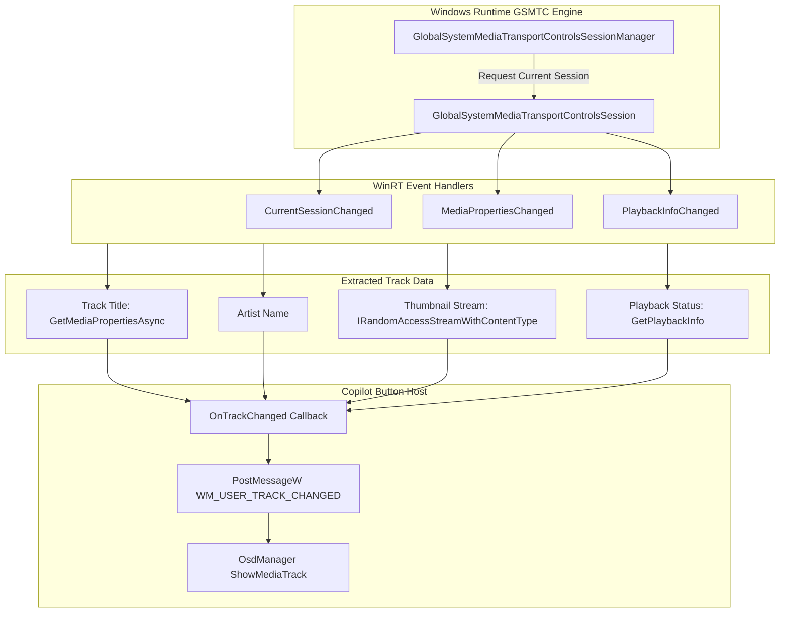

# Universal Media Manager Subsystem

## 1. Overview & Architecture

The media subsystem (`src/MediaTracker.cpp`, `include/MediaTracker.hpp`) provides real-time tracking of active media sessions across the Windows operating system. It interfaces directly with the Windows Runtime (WinRT) `GlobalSystemMediaTransportControlsSessionManager` (GSMTC) API.



---

## 2. Windows Runtime (WinRT) GSMTC Integration

### 2.1 Session Manager Acquisition
During startup, `MediaTracker::Start` acquires the global session manager asynchronously using modern C++/WinRT coroutines:
```cpp
m_manager = GlobalSystemMediaTransportControlsSessionManager::RequestAsync().get();
```

### 2.2 Event Subscriptions
To respond dynamically when media begins playing or changes track:
- `CurrentSessionChanged`: Raised when user changes active media application (e.g., switching from Spotify to YouTube in Edge).
- `MediaPropertiesChanged`: Raised when track advances, updating title, artist, and album artwork.
- `PlaybackInfoChanged`: Raised when playback state alters between Playing, Paused, or Stopped.

---

## 3. Metadata Extraction & Thumbnail Stream Decoding

When an update event fires, `MediaTracker::UpdateCurrentTrack` queries the active session:

### 3.1 Metadata Extraction
```cpp
auto session = m_manager.GetCurrentSession();
if (session) {
    auto mediaProps = session.TryGetMediaPropertiesAsync().get();
    if (mediaProps) {
        track.title = mediaProps.Title().c_str();
        track.artist = mediaProps.Artist().c_str();
    }
    auto playbackInfo = session.GetPlaybackInfo();
    track.isPlaying = (playbackInfo.PlaybackStatus() == GlobalSystemMediaTransportControlsSessionPlaybackStatus::Playing);
}
```

### 3.2 Thumbnail Byte Buffer Conversion
Album artwork is extracted from the WinRT `IRandomAccessStreamReference`:
1. `mediaProps.Thumbnail().OpenReadAsync().get()` opens the stream.
2. An `DataReader` reads byte streams from the `IRandomAccessStreamWithContentType`.
3. Bytes are copied into a standard `std::vector<uint8_t>` buffer stored in `TrackInfo::thumbnailData`.
4. `OsdManager` decodes this memory buffer via GDI+ `IStream` (`CreateStreamOnHGlobal`) into a native `Gdiplus::Bitmap` for antialiased rendering on the media card.

---

## 4. Transport Control Execution

Media transport commands are executed using two layers:
1. **GSMTC API Layer**: If an active session is bound, commands like `session.TryPlayAsync()`, `session.TryPauseAsync()`, `session.TrySkipNextAsync()`, or `session.TrySkipPreviousAsync()` can be invoked directly.
2. **Virtual Key Fallback**: Standard Windows media virtual keystrokes are synthesized via `keybd_event` or `SendInput`:
   - Play / Pause: `VK_MEDIA_PLAY_PAUSE` (`0xB3`)
   - Next Track: `VK_MEDIA_NEXT_TRACK` (`0xB0`)
   - Previous Track: `VK_MEDIA_PREV_TRACK` (`0xB1`)

This guarantees compatibility with both modern UWP / PWA players and legacy Win32 desktop media players.

