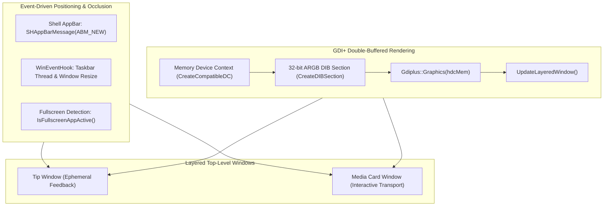
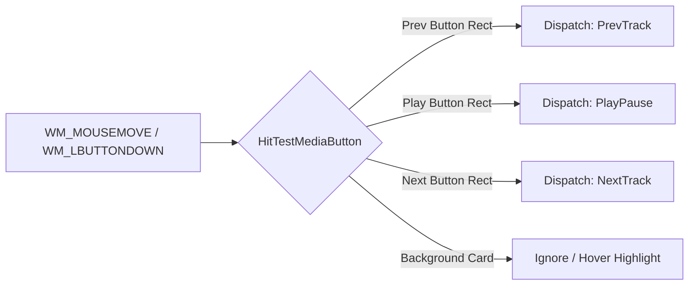

# On-Screen Display (OSD) Subsystem

## 1. Overview & Window Architecture

The On-Screen Display (OSD) subsystem provides visual feedback for gesture executions, mute toggles, and active media playback. Implemented in `src/Osd.cpp` and `include/Osd.hpp`, the subsystem manages two distinct top-level layered windows:

1. **Tip Window (`m_tipHwnd`)**:
   - An ephemeral badge displaying action names (e.g., "Microphone Muted", "Deafened", "Play / Pause").
   - Positioned according to `osdPosition` (`TopLeft`, `TopRight`, `BottomLeft`, `BottomRight`, `Center`).
   - Automatically fades out using a linear alpha animation after `osdDurationMs` (default 1500 ms).

2. **Media Card Window (`m_mediaHwnd`)**:
   - Displays track metadata (title, artist), decoded album artwork thumbnail, and interactive transport buttons.
   - Positioned above the taskbar according to `mediaOsdPosition` (default `BottomLeft`).
   - Can operate in ephemeral mode or persistent mode (`mediaOsdPersistent=1`).
   - Supports hit-testing and direct click events for track navigation.



---

## 2. Rendering Pipeline & Layered Window Setup

Both windows are constructed with extended styles:
`WS_EX_LAYERED | WS_EX_TOPMOST | WS_EX_TOOLWINDOW | WS_EX_NOACTIVATE`

### 2.1 Per-Pixel 32-bit ARGB Alpha Blending
To achieve antialiased typography and smooth translucent backdrops without flickering:
1. A 32-bit ARGB DIB section is created matching window dimensions.
2. Drawing is executed via GDI+ (`Gdiplus::Graphics`) with `SmoothingModeAntiAlias` and `TextRenderingHintClearTypeGridFit`.
3. Background rounded rectangles are rendered with a translucent dark fill (`Color(alpha, 18, 18, 22)`) and accent border.
4. The composite bitmap is submitted to the Desktop Window Manager via `UpdateLayeredWindow`:
   ```cpp
   BLENDFUNCTION bf{};
   bf.BlendOp = AC_SRC_OVER;
   bf.SourceConstantAlpha = static_cast<BYTE>(currentAlpha);
   bf.AlphaFormat = AC_SRC_ALPHA;
   UpdateLayeredWindow(hwnd, hdcScreen, &ptDst, &sizeWnd, hdcMem, &ptSrc, 0, &bf, ULW_ALPHA);
   ```

### 2.2 DWM Window Corner Rounding
On Windows 11, the windows request native rounded corners via the DWM attribute API:
```cpp
DWM_WINDOW_CORNER_PREFERENCE pref = DWMWCP_ROUND;
DwmSetWindowAttribute(hwnd, DWMWA_WINDOW_CORNER_PREFERENCE, &pref, sizeof(pref));
```

---

## 3. Event-Driven Taskbar Tracking & Positioning

Historical implementations used a 300 ms polling timer (`TIMER_ID_MEDIA_MONITOR`) to detect taskbar movements and fullscreen transitions. Release v3.1.1 replaced this with a purely event-driven architecture.

### 3.1 Shell AppBar Registration
The host window registers with the shell AppBar notification service during initialization:
```cpp
APPBARDATA abd{};
abd.cbSize = sizeof(abd);
abd.hWnd = m_hostWnd;
abd.uCallbackMessage = WM_USER_APPBAR_NOTIFY;
SHAppBarMessage(ABM_NEW, &abd);
```
When taskbar state, position, or fullscreen application status changes, the shell delivers `WM_USER_APPBAR_NOTIFY` (`ABN_POSCHANGED`, `ABN_FULLSCREENAPP`, `ABN_STATECHANGE`), triggering immediate coordinate re-anchoring.

### 3.2 WinEvent Hooking for Taskbar Thread
To instantly capture taskbar autohide transitions and Explorer window animations, a WinEvent hook targets the Explorer thread:
```cpp
DWORD threadId = GetWindowThreadProcessId(hTaskbar, &pid);
m_hTaskbarHook = SetWinEventHook(
    EVENT_OBJECT_SHOW, EVENT_OBJECT_LOCATIONCHANGE,
    nullptr, WinEventProc, pid, threadId, WINEVENT_OUTOFCONTEXT
);
```
An additional system hook (`EVENT_SYSTEM_MOVESIZEEND`) detects the completion of user window resize/move actions that may occlude taskbar boundaries.

---

## 4. Interactive Media Card & Hit-Testing

The media card window processes mouse events to provide direct transport controls without taking focus (`WS_EX_NOACTIVATE`):



### 4.1 Button Geometry & Hit Regions
Button bounding rectangles are calculated dynamically based on card width and text metrics:
- **Previous Button**: Left offset adjacent to track text.
- **Play/Pause Button**: Center transport button rendering dynamic play triangle or pause bars depending on `m_isMediaPlaying`.
- **Next Button**: Right offset adjacent to play button.

### 4.2 Mouse Tracking & Hover Animation
- Upon receiving `WM_MOUSEMOVE`, the window requests mouse leave tracking via `TrackMouseEvent` (`TME_LEAVE`).
- Hovered buttons trigger an invalidation and redraw with brightened alpha highlights.
- `WM_LBUTTONUP` dispatches the selected transport action via `DispatchAction`.

---

## 5. Fullscreen Application Occlusion Handling

To prevent the OSD from obstructing fullscreen games, presentations, or video players, `OsdManager::IsFullscreenAppActive` validates the active foreground window:
1. Retrieves `GetForegroundWindow()`.
2. Ignores the desktop shell (`Progman`, `WorkerW`) and the OSD windows themselves.
3. Compares the foreground window rectangle with the target monitor's full dimensions (`GetMonitorInfoW`).
4. If the window dimensions cover the entire monitor, `m_suppressedByFullscreen` is engaged and the OSD is hidden until fullscreen focus ends.

