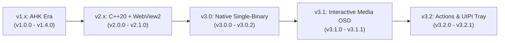

# Progress & Milestone Tracking

## 1. Project Progress & Milestone History

### 1.1 Milestone Breakdown

#### v1.x Era (AutoHotkey Initial Concept & Modularization)
- [x] Initial Copilot composite scan code interception (`VK_LWIN + VK_LSHIFT + VK_F23`).
- [x] 3-State Anti-Leak state machine concept with modifier buffering (25 ms / 15 ms) and 80 ms trailing suppression.
- [x] Push-to-Talk, Microphone Mute, Master Mute, and Discord-style Deafen toggle.
- [x] Multi-press gesture detection (1 to 4 taps) and press-and-hold action.
- [x] Inno Setup installer and auto-updater scripts.

#### v2.x Era (Transition to Native C++20 & Dual-Process GUI)
- [x] Rewrote low-level hook and core engine in native C++20.
- [x] Integrated Windows Core Audio COM API (`IAudioEndpointVolume`, `IMMDeviceEnumerator`).
- [x] Integrated WinRT `GlobalSystemMediaTransportControlsSessionManager` (GSMTC).
- [x] Embedded WebView2-based settings panel (superseded in v3.0).
- [x] Implemented self-relocation engine to `%LOCALAPPDATA%\CopilotButton`.

#### v3.0 Native Single-Binary Architecture (`v3.0.0` – `v3.0.2`)
- [x] Completely removed WebView2 dependency, reducing binary size to ~440 KB and RAM usage to <10 MB.
- [x] Replaced external GUI with direct Win32 system tray (`TrayManager`) and text editor INI launch.
- [x] Implemented native GDI+ layered OSD windows with DWM rounded corners (`DWMWCP_ROUND`).
- [x] Integrated Windows Settings (Installed apps) registration in `HKCU\Software\Microsoft\Windows\CurrentVersion\Uninstall`.
- [x] Replaced flaky registry `Run` keys with elevated Task Scheduler autostart (`/rl highest`).

#### v3.1 Interactive Media OSD & Event-Driven Engine (`v3.1.0` – `v3.1.1`)
- [x] Designed persistent interactive media card with album artwork byte decoding and transport buttons.
- [x] Added fullscreen app detection (`IsFullscreenAppActive`) suppressing OSD during games/videos.
- [x] Replaced 300 ms polling timer with Shell AppBar notifications and WinEvent hooks on Explorer thread.

#### v3.2 Actions, Configuration & UIPI Reliability (`v3.2.0` – `v3.2.1`)
- [x] Added `RunAgy` action with terminal options (`wt` or `cmd.exe`) and optional `F5` injection.
- [x] Added in-place UTF-8 BOM stripping (`StripUtf8Bom`) preventing Win32 INI parsing fallback.
- [x] Resolved UIPI message blocking for elevated tray icon communication via `ChangeWindowMessageFilterEx`.
- [x] Full persistent knowledge base and memory bank synchronization implemented.

---

## 2. Subsystem Functional Status

| Subsystem | Source Files | Test / Runtime Verification | Status |
| :--- | :--- | :--- | :--- |
| **Input Hook & Anti-Leak** | `src/KeyHook.cpp` | Verified on Windows 10/11 hardware; zero Start menu leakage. | **Production Ready** |
| **Actions Dispatcher** | `src/Actions.cpp` | Verified all actions (Mute, PTT, Media, RunAgy, LockScreen). | **Production Ready** |
| **Audio & Endpoints** | `src/Audio.cpp` | Core Audio COM callbacks verified with headset buttons. | **Production Ready** |
| **Media Tracker** | `src/MediaTracker.cpp` | WinRT GSMTC tested with Spotify, browsers, and media players. | **Production Ready** |
| **OSD Subsystem** | `src/Osd.cpp` | Layered windows, GDI+ rendering, and taskbar tracking verified. | **Production Ready** |
| **Mic Overlay** | `src/MicOverlay.cpp` | Live visual badge verified across display resolutions. | **Production Ready** |
| **Tray Subsystem** | `src/Tray.cpp` | UIPI filter and context menu verified in elevated mode. | **Production Ready** |
| **Config & Watcher** | `src/Config.cpp` | Live file watcher verified; UTF-8 BOM stripping verified. | **Production Ready** |
| **App Registration** | `src/AppRegister.cpp` | Task Scheduler autostart and uninstaller verified. | **Production Ready** |

---

## 3. Known Technical Constraints & Considerations

1. **Elevation Requirement (`requireAdministrator`)**:
   - Necessary to capture keyhooks when elevated windows (Task Manager, games running as admin, elevated terminals) are focused.
   - Requires ongoing vigilance regarding UIPI when receiving messages from non-elevated shell components.
2. **Hardware OEM Variations**:
   - Most laptops use `VK_LWIN + VK_LSHIFT + VK_F23`; some newer keyboards emit `VK_LAUNCH_APP1` or scan code `0x006E`. All variants are covered in `KeyHook.cpp`.
3. **WinRT API Threading Model**:
   - WinRT callbacks execute on internal thread pool threads; state must always be posted to the UI message thread.

